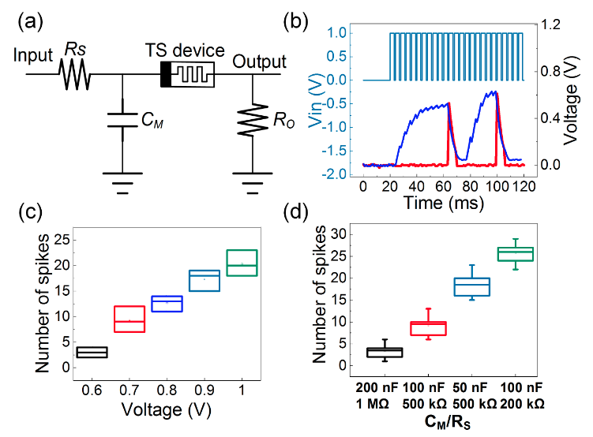

# Research: Hardware-aware in-situ learning in an analog spiking neural network.
James Carlyle, AI for Sustainability CDT, Sustainable Electronic Technologies, University of Southampton.
Supervised by Dr. Firman Simanjuntak and Prof. Mark Zwolinski, University of Southampton.

# Topics

## My goal

## What is a spiking neural network?

## What is a spiking neuron?

## What is a memristor?

## What is in-situ learning?

## What do we need hardware-awareness?

## Initial results

# My goal

The human brain is amazingly energy-efficient. It can perform an exaflop (10e18) with just 20 watts of power [1]. 

In traditional digital "Von-Neumann" architecture, data transfer between CPU and memory consumes 10-100x more energy than the logic operation [2]. In-memory computing (IMC) minimises data movement to improve efficiency. 

My research goal is to 

- **simulate** a multi-layer spiking neural network,
- **fabricate** it using all-analog electronic devices,
- then **train** it using on-chip learning methods, 
- and understand whether **variability** enables or hinders performance.

<!-- _footer: "1. https://www.nist.gov/blogs/taking-measure/brain-inspired-computing-can-help-us-create-faster-more-energy-efficient. 

2. https://arxiv.org/abs/2401.14428" -->

# What is a spiking neural network?

Similar to artificial neural network : weights -> **synapses**, nodes -> **neurons**. Information is encoded by spike frequency or timing, not by amplitude.

<!-- _footer: "1. https://www.sciencedirect.com/science/article/pii/S0167865524002344" -->

# What is a spiking neuron?

The spiking behaviour of a neuron is a **non-linear activation function**, equivalent to sigmoid or ReLU in ANN.

<!-- _footer: "1. https://medium.com/thedeephub/understand-spiking-neural-network-through-code-implementation-8b48fc7f096b" -->

# Biological neurons exhibit 6 main behaviours:

1. integration 
2. threshold firing
3. cascading spikes
4. homeostastis (firing reduces sensitivity)
5. refactory period
6. stochasticity

<!-- _footer: "1. https://www.nature.com/articles/s41928-025-01488-x" -->

# What is a memristor?

Leon Chua predicted the memristor, the missing 4th fundamental passive device, in 1971. 

- Flux is the integral of voltage; charge is the integral of current.
- Resistor relates voltage and current.
- Inductor relates flux and current.
- Capacitor relates charge and voltage.
- **Memristor** relates flux and charge.

Researchers at HP Labs built the first working memristor in 2008.

<!-- _footer: "1. https://www.nature.com/articles/s41928-018-0074-4" -->

# What roles can memristors play in neuromorphic computing?

- As a synapse, with a programmable weight. This requires **non-volatile** behaviour, as the memristor creates a summable current based on a known voltage at a known resistance.
- As a neuron, with a highly non-linear voltage-dependent resistance. This requires repeatable, consistent **volatile** behaviour, as the memristor breaks down at a known voltage threshold to generate an output spike.

# What types of memristor exist? 

4 types of memristor (even the taxonomy is debated):

- **Resistive switching**, notably **metal-cation filaments** through oxygen-vacancy defects.
- Phase change.
- Spintronics.
- Ferroelectric.

<!-- _footer: "1. https://advanced.onlinelibrary.wiley.com/doi/full/10.1002/aisy.202000105" -->

# How do filaments integrate voltage and current?

- Memristance behaves like a resistance which depends on the history of charge that has flowed through the device.
- Typical memristor: Ag electrode | ZnO insulator layer | Pt electrode.  
- Applying a voltage across electrodes, the Ag (silver) is oxidised to form Ag+ ions + electrons.
- Ag+ ions migrate through ZnO defects, reduced at the anode to Ag, and form a cluster which begins to bridge the electrodes.
- The reduced gap increases the local electric field and accelerates migration.
- A complete bridge moves the memristor from high resistive state (HRS) to low resistive state (LRS).

<!-- _footer: "1. https://advanced.onlinelibrary.wiley.com/doi/full/10.1002/aisy.202000105" -->

# What is in-situ (on-chip) learning?

- Spiking Neural Networks cannot use standard back-propagation, as the spikes cannot be differentiated. 
- Surrogate gradient descent is one work-around, normally used off-chip. 
- Spike Timing-Dependent Plasticity (STDP) depends on the relative timing of spikes of pre-synaptic and post-synaptic neurons. An example of Hebbian learning: "Neurons which fire together wire together."

<!-- _footer: "1. https://www.nature.com/articles/s41467-018-07757-y" -->

# What is in-situ (on-chip) learning?

- STDP relies on the spike timing difference of neighbouring neurons.
- A variant, Voltage Dependent Synaptic Plasticity (VDSP) relies on voltage difference between the "pre-synaptic neuron" and the "post-synaptic" neuron at its firing point.
- VDSP relies on a negative reset voltage and an observable decay to a resting voltage.
- Weight update is proportional to the voltage difference.

<!-- _footer: "1. https://www.frontiersin.org/journals/neuroscience/articles/10.3389/fnins.2022.983950/full" -->

# What do we need hardware-awareness?

- Memristors have significant Cycle-to-Cycle (C2C) and Device-to-Device (D2D) variability.
- Often used in research as a source of entropy in random number generation. 
- For synapses, we can accept C2C and D2D variability during training (e.g. more or fewer potentiation pulses) as long as we can continue to modify resistance in the right direction. We need stable resistance during inference.
- For neurons, low C2C variability and consistent threshold firing is needed.

<!-- _footer: "1. https://ieeexplore.ieee.org/document/9131823" -->

# Initial results
