# Research: 
# Hardware-aware in-situ learning in an analog spiking neural network.

James Carlyle, AI for Sustainability CDT, Sustainable Electronic Technologies, University of Southampton.
Supervised by Dr. Firman Simanjuntak and Prof. Mark Zwolinski, University of Southampton.

# Topics

- My goal

- What is a spiking neural network?

- What is a spiking neuron?

- What is a memristor?

- What neuromorphic roles can a memristor play?

- Let's talk about variability.

- What is in-situ learning?

- How does variabililty affect the ability to learn?

# My goal
<!-- _class: images-below -->

- The human brain is amazingly energy-efficient. It can perform an exaflop (10e18) with just 20 watts of power [1]. 
- In traditional digital "Von-Neumann" architecture, data transfer between CPU and memory consumes 10-100x more energy than the logic operation [2]. In-memory computing (IMC) minimises data movement to improve efficiency.
- Analog nano-scale devices can use pico or femto Joules of energy, but exhibit intrinsic variability.

My research goal is to:

- **characterise** existing memristors,
- **simulate** a multi-layer spiking neural network using collected data,
- **build** it using newly-fabricated memristor devices,
- then **train** it using on-chip learning methods, 
- and understand whether **variability** enables or hinders performance.

<!-- _footer: "1. https://www.nist.gov/blogs/taking-measure/brain-inspired-computing-can-help-us-create-faster-more-energy-efficient. 

2. https://arxiv.org/abs/2401.14428" -->

# What is a spiking neural network?
<!-- _class: images-below -->

- Similar to artificial neural network : **synapses** have weights, **neurons** are nodes. 
- Information is encoded by spike frequency or timing, not by amplitude.

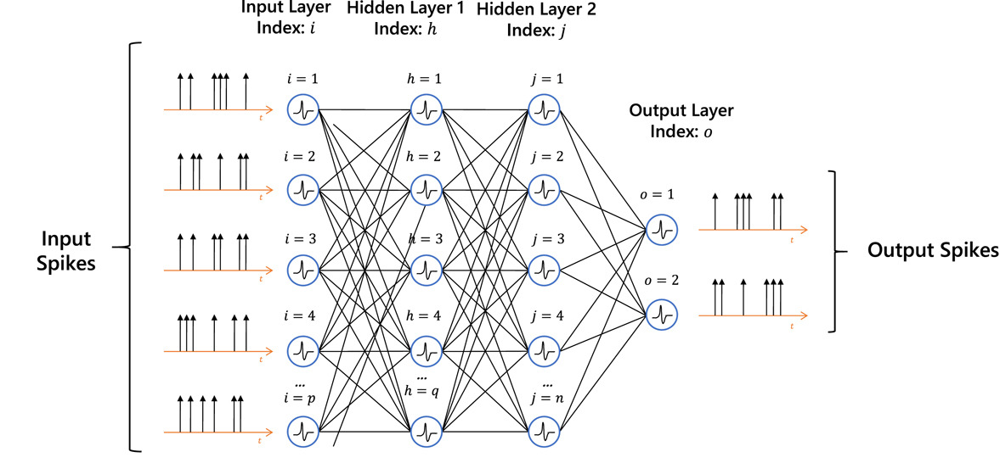

<!-- _footer: "1. https://www.sciencedirect.com/science/article/pii/S0167865524002344" -->

# What is a spiking neuron?
<!-- _class: images-below -->

The spiking behaviour of a neuron is a **non-linear activation function**, equivalent to sigmoid or ReLU in ANN.

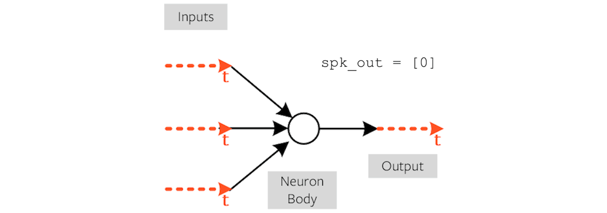

<!-- _footer: "1. https://medium.com/thedeephub/understand-spiking-neural-network-through-code-implementation-8b48fc7f096b" -->

# Biological neurons exhibit 6 main behaviours:
<!-- _class: images-right -->

1. Integration.
2. Threshold firing.
3. Cascading spikes.
4. Homeostastis (firing reduces sensitivity).
5. Refactory period.
6. Stochasticity.

Some of these behaviours may only be a consequence of biological chemistry and not relevant to training and inference. 

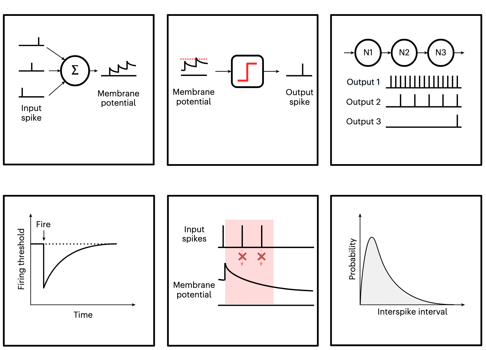

<!-- _footer: "1. https://www.nature.com/articles/s41928-025-01488-x" -->

# What is a memristor?
<!-- _class: images-right -->

Leon Chua predicted the memristor, the missing 4th fundamental passive device, in 1971. 

- Flux is the integral of voltage
- Charge is the integral of current.
- A Resistor relates voltage and current.
- An Inductor relates flux and current.
- A Capacitor relates charge and voltage.
- A **Memristor** relates flux and charge.

Researchers at HP Labs built the first working memristor in 2008.

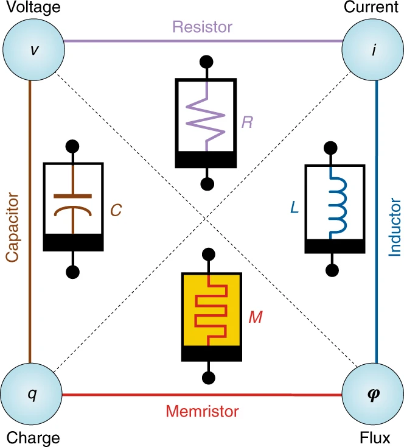

<!-- _footer: "1. https://www.nature.com/articles/s41928-018-0074-4" -->

# What types of memristor exist? 
<!-- _class: images-right -->
There are 4 types of memristor (even the taxonomy is debated):

- **Resistive switching**, notably **metal-cation filaments** through oxygen-vacancy defects.
- Phase change.
- Spintronics.
- Ferroelectric.

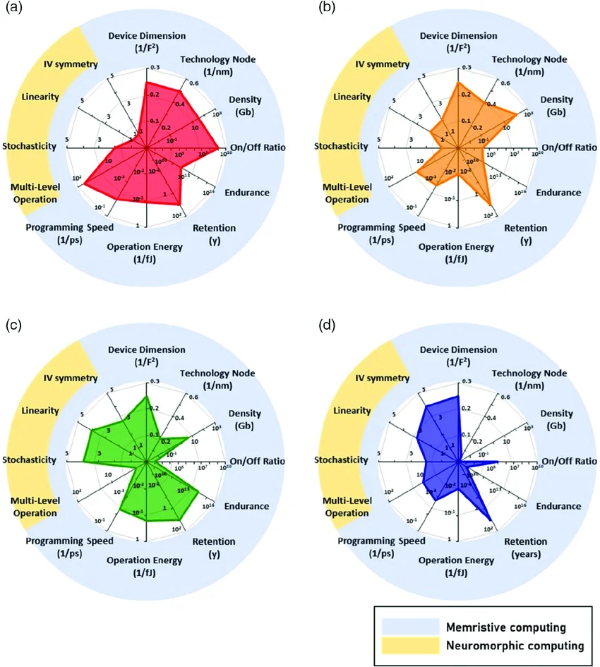

<!-- _footer: "1. https://advanced.onlinelibrary.wiley.com/doi/full/10.1002/aisy.202000105" -->

# How do filaments integrate voltage and current?
<!-- _class: images-below -->

- Memristance behaves like a resistance which depends on the history of charge that has flowed through the device.
- Typical memristor: Ag electrode | ZnO insulator layer | Pt electrode.  
- Applying a voltage across electrodes, the Ag (silver) is oxidised to form Ag+ ions + electrons.
- Ag+ ions migrate through ZnO defects, reduced at the anode to Ag, and form a cluster which begins to bridge the electrodes.
- The reduced gap increases the local electric field and accelerates migration.
- A complete bridge moves the memristor from high resistive state (HRS) to low resistive state (LRS).

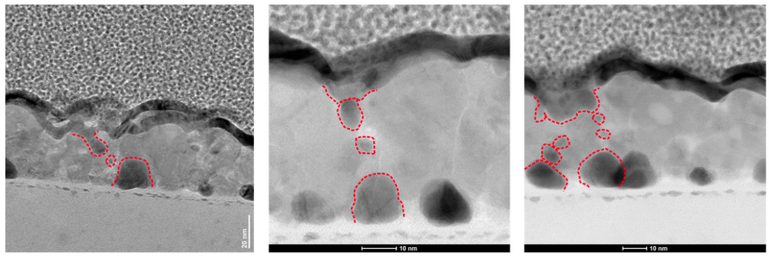

<!-- _footer: "1. https://advanced.onlinelibrary.wiley.com/doi/full/10.1002/aisy.202000105" -->

# What roles can memristors play in neuromorphic computing?
<!-- _class: images-right -->

- As a **synapse**, with a programmable weight. 
- This requires **non-volatile** behaviour.
- A memristor array can create a summable current based on known applied voltages at known conductances.

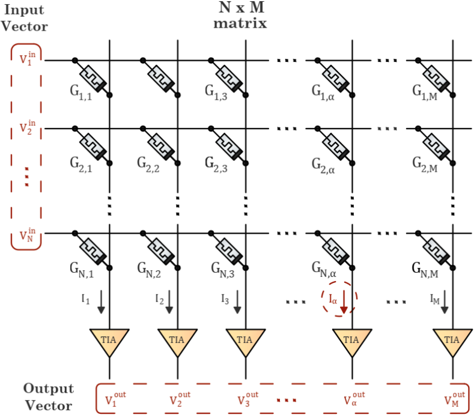

<!-- _footer: "1. https://www.nature.com/articles/s41928-018-0074-4" -->

# What roles can memristors play in neuromorphic computing?
<!-- _class: images-right -->

- As a **neuron**, with a highly non-linear voltage-dependent conductance. 
- A sudden increase in conductance generates an output spike.
- This requires repeatable, consistent **volatile** behaviour.

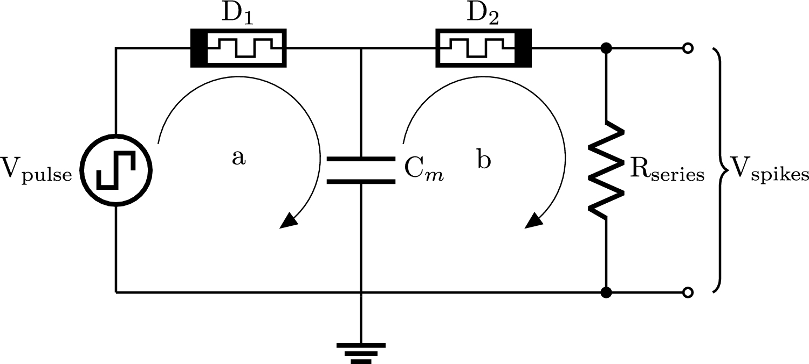
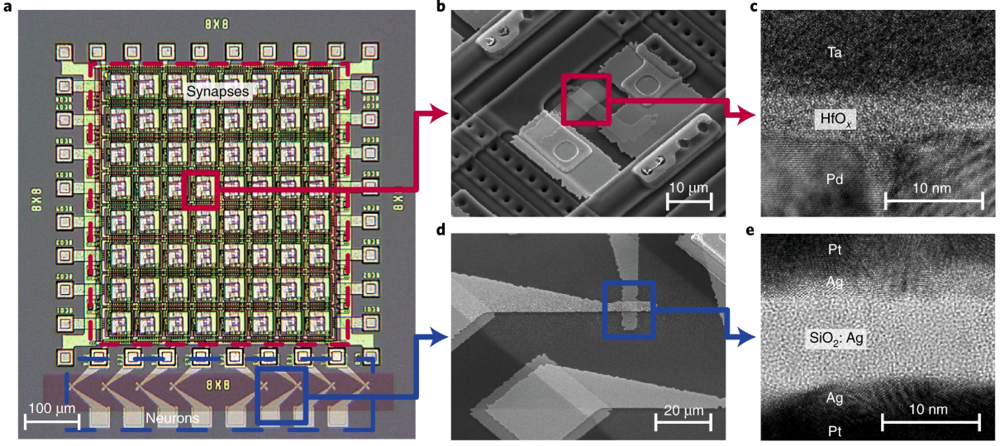

<!-- _footer: "1. https://www.nature.com/articles/s41928-018-0074-4" -->

# Variability in memristors as synapses
<!-- _class: images-below -->

- Memristors exhibit Cycle-to-Cycle (C2C) and Device-to-Device (D2D) variability.
- Often used in research as a source of entropy in random number generation. 
- During training, C2C and D2D variability can be tolerated with more or fewer potentiation pulses as long as conductance continues to converge. It does imply device-specific training.
- During inference, stable read-to-read conductance is needed.

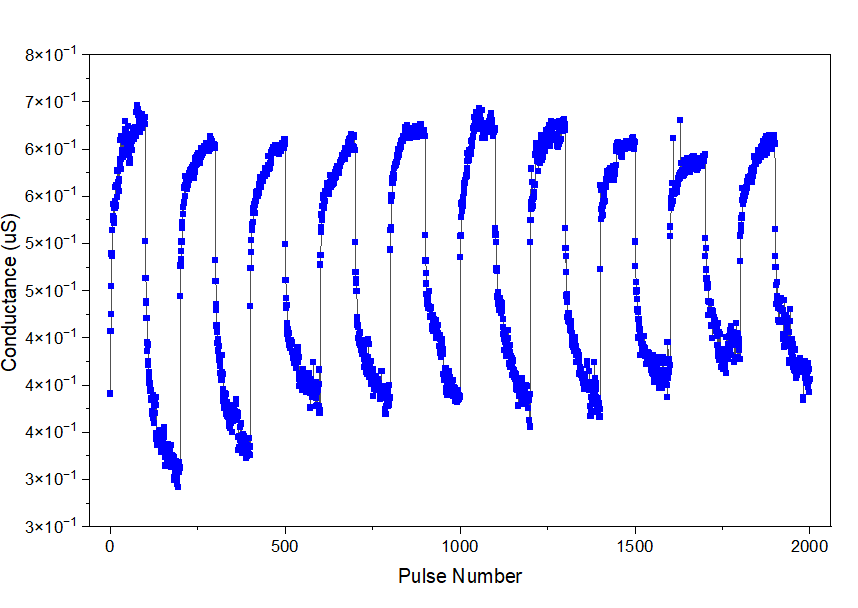

<!-- _footer: "1. Aidan Graham, TaOx memristor potentiation and depression response, 2026." -->

# Variability in memristors as neurons
<!-- _class: images-right -->

- For neurons, low C2C variability and consistent threshold firing is needed.
- First device characterisation results of 2022 ZnO/Ag fabricated wafers were promising.
- Further tests demonstrated a high-resistance-state (HRS) to low-resistance-state (LRS) transition voltage between 1V and 3.5V.
- Research is needed into the effects of variability on accuracy.

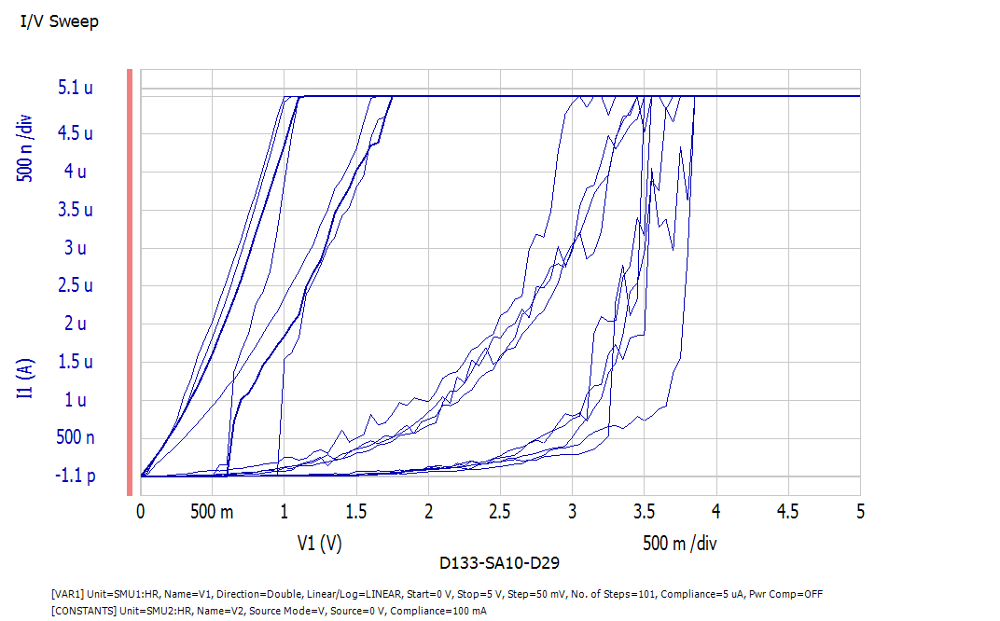
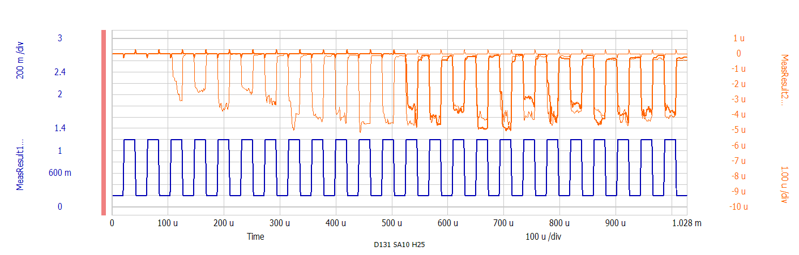

<!-- _footer: "1. James Carlyle, ZnO/Ag, I/V sweep 5V 10uA compliance.

2. James Carlyle, ZnO/Ag, 3 pulse 4V 5uS.

3. James Carlyle, ZnO/Ag, I/V sweep 5V 5uA compliance.

4. James Carlyle, ZnO/Ag, 20 pulse 1.2V 10uS." -->

# What is in-situ (on-chip) learning?
<!-- _class: images-right -->

- Spiking Neural Networks cannot use standard back-propagation, as the spikes cannot be differentiated. 
- Surrogate gradient descent is one work-around, normally used off-chip. 
- Spike Timing-Dependent Plasticity (STDP) depends on the relative timing of spikes of pre-synaptic and post-synaptic neurons. 
- An example of Hebbian learning: "Neurons which fire together wire together."

On-chip learning may require complex peripheral circuitry. 

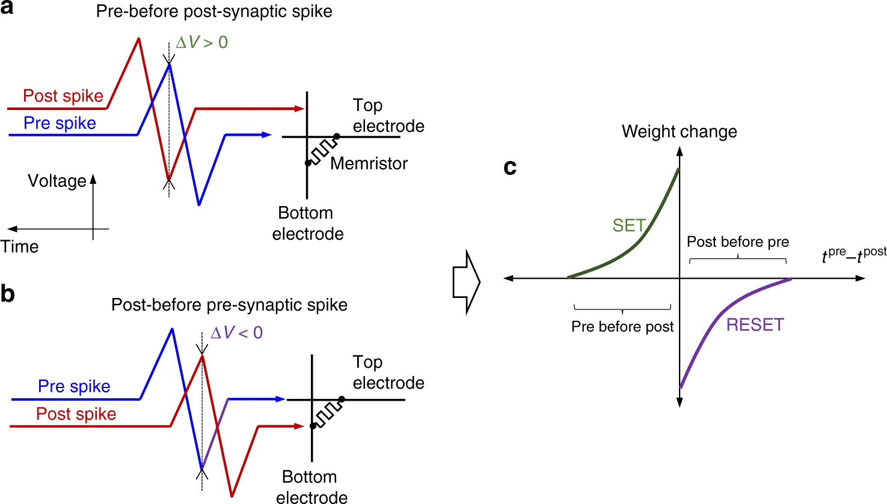

<!-- _footer: "1. https://www.nature.com/articles/s41467-018-07757-y" -->

# What is in-situ (on-chip) learning?
<!-- _class: images-right -->

- A variant, Voltage Dependent Synaptic Plasticity (VDSP) relies on voltage difference between the "pre-synaptic neuron" and the "post-synaptic" neuron at its firing point.
- VDSP relies on a negative reset voltage and an observable decay to a resting voltage.
- Weight update is proportional to the voltage difference.

Compact and low-energy circuit design for on-chip learning is expected to be a critical success factor. ​

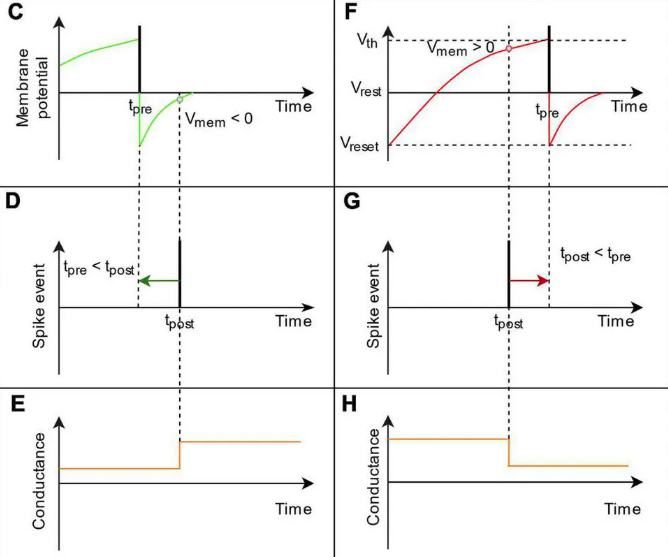

<!-- _footer: "1. https://www.frontiersin.org/journals/neuroscience/articles/10.3389/fnins.2022.983950/full" -->

# STDP learning simulation
<!-- _class: images-right -->

- Python/C++ Brian2 spiking neural network package is chosen simulate the effect of controlled variability in neuron parameters and the effectiveness of STDP as a learning approach.
- Baseline model follows the 2015 paper of Diehl & Cook, "Unsupervised learning of digit recognition using STDP" with Poisson rate encoding of image pixel intensity.
- Initial results demonstrate a classification precision of 88% and recall of 88% achieved after training on 60,000 MNIST samples. Being used to provide a baseline for future variability research.

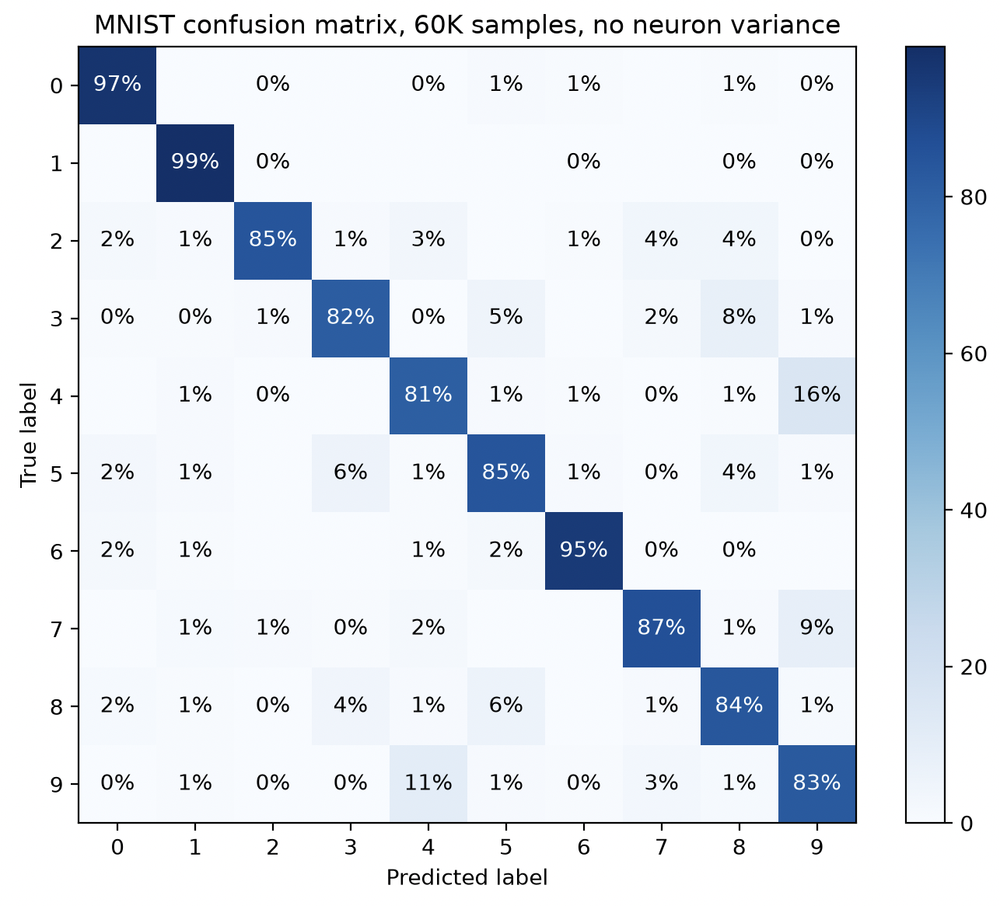 

<!-- _footer: "1. https://brian2.readthedocs.io/en/stable/examples/frompapers.Diehl_Cook_2015.html"-->

# What effect does memristor variability have on learning?
<!-- _class: images-right -->

- Spiking threshold variability is introduced to see the impact on feature detections.
- First variability tested is spike-to-spike threshold variability, with S.D. of 5mV added to each spike cycle for all nodes during training and testing.
- Precision falls to 16% and recall falls to 13%.  
- Further studies evaluating the impact on accuracy of the degree and the type of variability will be undertaken.

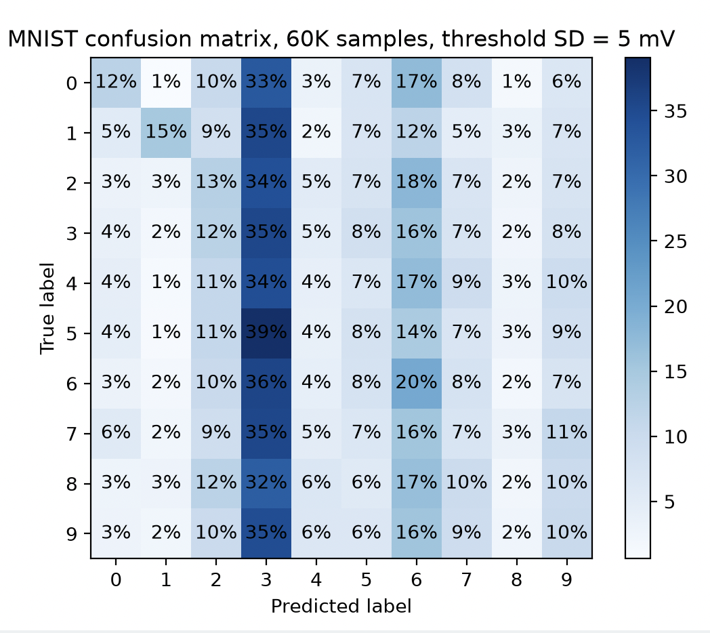 

<!-- _footer: "1. Same model, but spike-to-spike 5mV threshold standard deviation applied."-->

# Conclusions

- Characterisation results show significant variability in cycle-to-cycle spike formation and rupture. 
- Simulated STDP learning of the MNIST dataset demonstrates that threshold firing variability has an impact on the ability of a spiking neural network to learn effectively, 
- This may limit the utility of analog spiking neuromorphic computing in practice. 
- More work is required to understand the tolerable level of variability.

James Carlyle
james.carlyle@soton.ac.uk
